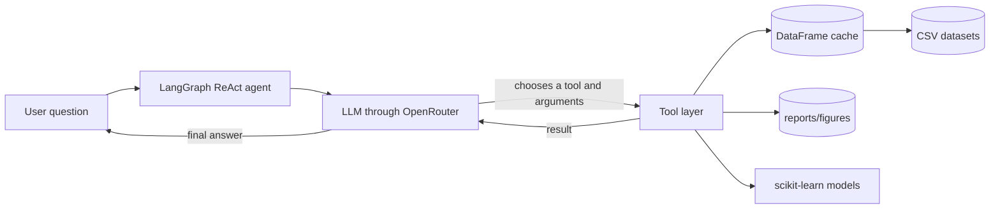
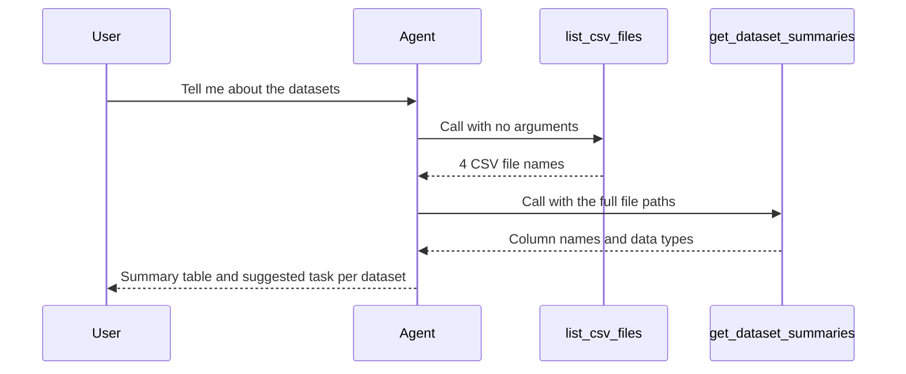
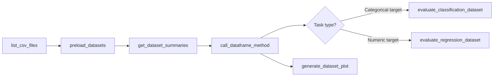
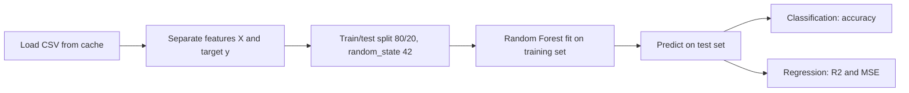

# AI-Powered Data Analyst Agent

A conversational agent that analyzes CSV datasets using tool calling. The user asks a question in plain language. The agent decides which Python tools to run, then explains the result: dataset summaries, plots, and machine learning evaluation (classification accuracy and regression scores).

Built with LangChain, LangGraph, scikit-learn, and an LLM served through OpenRouter. Developed and tested in Google Colab.

## What the agent can do

- Find the CSV files available in a folder
- Load datasets once and cache them in memory
- Describe the columns and data types of each dataset
- Run simple pandas methods (`head`, `tail`, `describe`)
- Train and evaluate a classification model (accuracy)
- Train and evaluate a regression model (R2 score and mean squared error)
- Generate and save charts (scatter, histogram, boxplot)
- Decide on its own whether a dataset fits classification or regression

## Architecture

The LLM does not run code directly. It chooses from a fixed set of Python functions (tools), and LangGraph runs the loop between the model and the tools.



## How the agent reasons (ReAct loop)

ReAct means Reasoning and Acting. The agent thinks, calls one tool, reads the result, then decides the next step. This is why it starts by listing files before analyzing anything.



## Tools

| Tool | Purpose |
|---|---|
| `list_csv_files` | Lists CSV files in the data folder |
| `preload_datasets` | Loads CSV files into a global cache to avoid reloading and save tokens |
| `get_dataset_summaries` | Returns column names and data types for each dataset |
| `call_dataframe_method` | Runs a no-argument pandas method by name (`head`, `tail`, `describe`) |
| `evaluate_classification_dataset` | Trains a Random Forest classifier and returns accuracy |
| `evaluate_regression_dataset` | Trains a Random Forest regressor and returns R2 and MSE |
| `generate_dataset_plot` | Saves a scatter plot, histogram, or boxplot to `reports/figures/` |

Typical order in which the agent uses the tools:



## Machine learning evaluation pipeline

Both evaluation tools use the same simple pipeline.



## Datasets

The agent was tested on the sample datasets that ship with Google Colab:

| Dataset | Task | Target |
|---|---|---|
| `california_housing_train.csv` and `california_housing_test.csv` | Regression | `median_house_value` |
| `mnist_train_small.csv` and `mnist_test.csv` | Classification | First column (digit label 0 to 9) |

## Tech stack

- Python 3
- LangChain and `langchain-openai` for tool definitions and the model client
- LangGraph (`create_react_agent`) for the agent loop
- OpenRouter as the LLM gateway
- pandas and NumPy for data handling
- scikit-learn for Random Forest models and metrics
- matplotlib and seaborn for charts

## Getting started

1. Open the notebook in Google Colab.
2. Add your OpenRouter key as a Colab secret named `OPENROUTER_API_KEY`.
3. Install the dependencies:

```bash
pip install langchain langchain-openai langgraph openai pandas numpy matplotlib seaborn scikit-learn
```

4. Run the notebook cells in order. The last interactive cell opens a chat loop.
5. Type questions such as:
   - `give me the summary of the datasets`
   - `classify the classification dataset and evaluate the accuracy`
   - `plot the distribution of median_income`
   - `type exit to quit`

## Project structure

```
AI-POWERD_AGENT.ipynb      Notebook with tools, agent, and chat loop
reports/figures/           Charts generated by the agent
```

## Known limitations

This is a first version built for learning. These points are known and planned for improvement:

- The accuracy metric alone can be misleading on unbalanced data. Precision and recall are not reported yet.
- Models are evaluated with a single train/test split. There is no cross-validation and no baseline model to compare against.
- Categorical and text columns are not encoded, and features are not cleaned or scaled before training.
- `list_csv_files` returns file names, while other tools need full paths. The chat loop works around this with a system reminder.
- The data folder path is hard-coded for Google Colab.
- `create_react_agent` is deprecated in LangGraph 1.0. The replacement is `create_agent` from `langchain.agents`.
- The model name is set to `auto` on OpenRouter, so the exact model can change between runs.

## Roadmap

- Add precision, recall, F1, and a confusion matrix
- Add cross-validation and a baseline model
- Add automatic data cleaning and encoding
- Support user-uploaded CSV files
- Support French and Arabic questions
- Replace the notebook chat loop with a web interface
- Save a short business-language summary with every analysis

## Author

Abdelhamid, AI and Software Engineering student and founder of Nexqor, Morocco.
