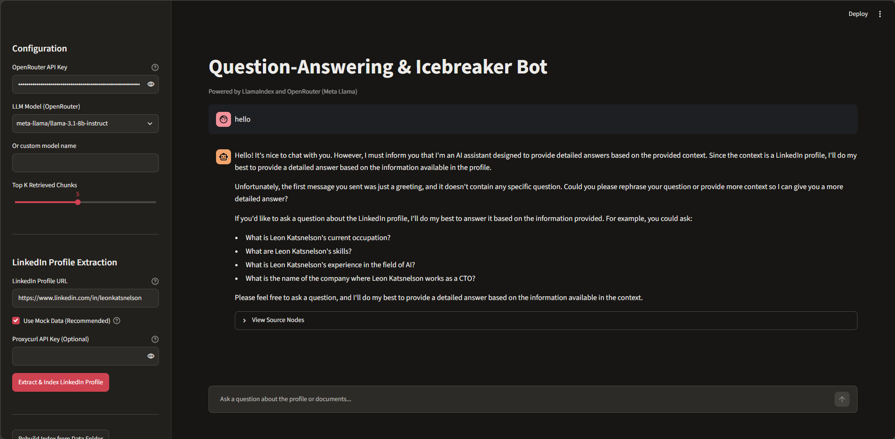

# RAG Application with LlamaIndex & OpenRouter

A modular, production-ready **Retrieval-Augmented Generation (RAG)** application built with **LlamaIndex**, **Meta Llama models via OpenRouter**, and **local HuggingFace vector embeddings**. 

The system enables semantic document question-answering over local files and includes an **Icebreaker Bot** that extracts, indexes, and synthesizes interesting facts from LinkedIn profiles.

<p align="center">
  
</p>

---

##  Key Features

- **Meta Llama via OpenRouter**: Ground responses using state-of-the-art open models such as `meta-llama/llama-3.1-8b-instruct` and `meta-llama/llama-3.3-70b-instruct`.
- **Zero-Cost Local Embeddings**: Uses `BAAI/bge-small-en-v1.5` running locally via HuggingFace for fast, cost-free embedding generation without external API dependencies.
- **Dual Interface**:
  -  **Streamlit Web UI**: Interactive chat interface, source node inspection with similarity scores, and one-click LinkedIn profile indexing.
  -  **Command-Line Interface (CLI)**: Interactive chat loop and single-query execution script.
- **LinkedIn Profile Extraction & Icebreaker**:
  - Ingests LinkedIn profile data (live via Proxycurl or free offline mock mode).
  - Automatically synthesizes 3 interesting facts about the person's career and education.
- **Persistent Vector Storage**: Saves vector indices to disk (`storage/`) for instant subsequent startup without re-embedding.

---

##  Project Architecture

```
├── app.py                   # Streamlit web application interface
├── main.py                  # Command-line interface (CLI) entrypoint
├── config.py                # Central configuration and environment loader
├── requirements.txt         # Project dependencies
├── .env.example             # Example environment configuration template
├── .gitignore               # Git exclusions (credentials, indices, cache)
├── data/                    # Directory for source documents (.txt, .pdf, etc.)
│   └── sample.txt           # Sample reference document
└── src/                     # Core RAG pipeline modules
    ├── __init__.py
    ├── data_extraction.py   # Document loading & LinkedIn profile extraction
    ├── data_processing.py   # Text chunking (SentenceSplitter) & node conversion
    ├── llm_interface.py     # OpenRouter LLM & HuggingFace embedding configuration
    └── query_engine.py      # Vector index persistence, loading, and QA execution
```

---

##  Quick Start Guide

### 1. Prerequisites
- Python 3.10 or higher
- An OpenRouter API Key ([get one here](https://openrouter.ai/keys))

### 2. Clone the Repository
```bash
git clone https://github.com/your-username/rag-llamaindex-openrouter.git
cd rag-llamaindex-openrouter
```

### 3. Create and Activate a Virtual Environment
```bash
# Windows (PowerShell)
python -m venv venv
.\venv\Scripts\Activate.ps1

# Linux / macOS
python3 -m venv venv
source venv/bin/activate
```

### 4. Install Dependencies
```bash
pip install -r requirements.txt
```

### 5. Configure Environment Variables
Copy `.env.example` to `.env` and insert your OpenRouter API key:
```bash
cp .env.example .env
```
Inside `.env`:
```ini
OPENROUTER_API_KEY=sk-or-v1-your-actual-api-key
LLM_MODEL=meta-llama/llama-3.1-8b-instruct
EMBEDDING_MODEL=BAAI/bge-small-en-v1.5
```

---

##  Running the Application

### Option A: Streamlit Web UI
Launch the interactive web application in your browser:
```bash
streamlit run app.py
```
Open [http://localhost:8501](http://localhost:8501) in your browser:
- Extract & index any LinkedIn profile (or use pre-loaded mock data).
- View initial icebreaker facts.
- Ask questions and inspect retrieved source citations.

### Option B: Command-Line Interface (CLI)

#### **1. Interactive Chat Loop:**
```bash
python main.py
```
Outputs initial facts and lets you ask questions continuously in your terminal.

#### **2. Single Question Direct Query:**
```bash
python main.py "What are the primary technical skills mentioned in the profile?"
```

---

##  Configuration Options

All settings can be customized in `config.py` or overridden via environment variables in `.env`:

| Setting | Default Value | Description |
|---|---|---|
| `OPENROUTER_API_KEY` | *(None)* | Your OpenRouter authorization key |
| `LLM_MODEL` | `meta-llama/llama-3.1-8b-instruct` | LLM model identifier on OpenRouter |
| `EMBEDDING_MODEL` | `BAAI/bge-small-en-v1.5` | Dense vector embedding model |
| `CHUNK_SIZE` | `400` | Token size per chunk |
| `CHUNK_OVERLAP` | `20` | Overlap tokens between adjacent chunks |
| `SIMILARITY_TOP_K` | `5` | Number of context chunks retrieved per query |
| `TEMPERATURE` | `0.0` | Sampling temperature for factual consistency |

---

##  Security Best Practices

- **Never commit `.env`**: Always keep your API keys in `.env` (already added to `.gitignore`).
- **Data Privacy**: Vector embeddings and document chunks stay locally on your machine. Only the retrieved prompt context and user queries are sent to OpenRouter.

---

##  License
MIT License. Feel free to use and modify for your own projects!
